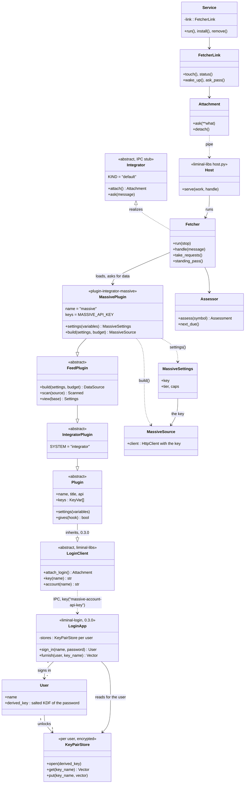

# The integrator's classes, and a plugin's authorization through liminal-login

A class diagram of liminal-integrator with the authorization path of one plugin, Massive
(`plugin-integrator-massive`), through the login app as designed on 2026-11-03 (the user: "the
authorization app, liminal-login, is kind of the root authorization for all plugins and software
integration, it provides the plugins with all the key and account infrastructure"; "each plugin, and
software component needs to inherit the liminal-login 'class' which allows the plugin IPC with the
actual login app"; keys as key-vector pairs for the logged-in user, like `massive-account-api-key`;
"each user has a key pair db which is encrypted by the user password"). The login pieces are the
0.3.0 design; the integrator's classes, the plugin contract and the hosts exist today.

## The authorization path, step by step

1. The user signs in to liminal-login (`LoginApp.sign_in`): the password is never stored; a key is
   derived from it (a salted KDF) and unlocks that user's `KeyPairStore`, a database of key-vector
   pairs of their own (`massive-account-api-key`, `massive-account-name`, `claude-account-api-key`,
   ...), encrypted with that derived key. Only the running login instance can open it.
2. The integrator (today `Fetcher` under its `Host`; at 0.3.0 a realization of the `Integrator` IPC
   stub) loads `MassivePlugin` through the registry.
3. `MassivePlugin` is a `Plugin`, and every `Plugin` (and every software component) inherits
   `LoginClient`, the login base class in liminal-libs: `attach_login()` opens the pipe to the login
   app, `key("massive-account-api-key")` asks it for the logged-in user's vector.
4. `LoginApp.furnish` answers with the API key (or the account name, or a password) read from the
   user's store; nothing else on the machine can furnish it.
5. `MassivePlugin.settings(variables)` builds `MassiveSettings` with that key, and `build(settings,
   budget)` makes the `MassiveSource` whose HTTP client sends it to Massive.

Today, before liminal-login exists, step 3-4 is `config.saved_user_keys()`: the key is read from the
user environment variable `MASSIVE_API_KEY` (a `KeyVar` the plugin declares), set by the Plugins view
or `tools/set-key.ps1`, never written to a file.

## The integrator's own classes

- `Fetcher` (fetcher.py): the stack of requests, the assessment (`Assessor`, one per tick, giving
  `Assessment`s), the standing pass, the feeds' runs held through `Attachment`s, its status; it runs
  under a `Host` (liminal-libs host.py, one per database) and answers `status`, `pass` and `wake`
  over the pipe (`handle`).
- `Service` (service.py): the integrator's process from the command line or the user's logon
  (`LogonTask` on Windows, `UserUnit` on Linux, the installers); it serves the page and the data API
  itself at LIMINAL_FETCHER_PORT (the charts app's `serve_integrator`) and holds the fetcher through
  a `FetcherLink` while a page is in touch, or for good as the daemon.
- `FetcherLink` (service.py): this process's hold on the fetcher host over the pipe: a page in touch
  attaches it (started if none answers), quiet lets it go; status, wake and pass over the pipe.
- The command line (cli.py): `serve`, `status`, `request`, `pass`, `cancel`, `host`; `service
  install|remove|status|run`; `apply_instance` for `--name`, `--db`, `--plugins`.
